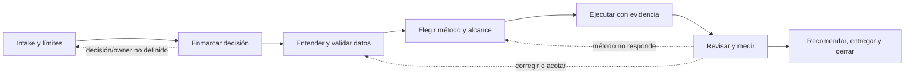

# Agentic Consulting OS

**Versión:** 2.0 · **Fecha:** 4 de octubre de 2026 · **Responsable:** David Rodríguez  
**Ámbito:** consultoría Data & AI / Data Science con apoyo de agentes.

> Convertir preguntas de negocio en decisiones defendibles mediante evidencia revisable, análisis reproducible y entregables claros. Los agentes ejecutan tareas acotadas; el consultor conserva criterio, autoridad y responsabilidad.

Este archivo es el punto de entrada y mapa del OS. Los módulos enlazados contienen la guía operativa detallada. Se redactan en español y conservan nombres oficiales y términos técnicos en inglés cuando aportan precisión.

## Inicializador portable

La CLI ACOS instancia este método mediante perfiles confirmados y composición modular. Consulta [instalación](docs/acos/installation.md) y [operación del proyecto](docs/acos/project-usage.md). La instalación actual es desde el checkout o wheel local; el paquete todavía no está publicado en PyPI.

## Propósito y principios

- Empezar por la decisión y la acción que podría cambiar; elegir datos, métodos y herramientas después.
- Usar el método menos complejo que pueda responder con suficiente evidencia. No hacer ML por defecto.
- Separar hechos, inferencias, hipótesis y recomendaciones; documentar fuentes, supuestos y limitaciones materiales.
- Mantener al consultor responsable de alcance, interpretación, aprobación y comunicación.
- Aislar trabajo y contexto de cada cliente mediante controles efectivos de acceso. Una carpeta, repo o worktree ayuda a organizar, pero no es por sí mismo una barrera de seguridad.
- Crear únicamente artifacts necesarios para ejecutar, revisar, retomar o entregar el trabajo.
- Tratar integraciones y capacidades como opcionales; verificar disponibilidad, versión, permisos y precondiciones antes de depender de ellas.

## Ciclo de consultoría

El trabajo avanza por gates con retornos cuando la evidencia o el alcance cambian:



El detalle de preguntas, salidas, gates y condiciones de retorno está en [`workflow/project-lifecycle.md`](workflow/project-lifecycle.md).

### Rutas metodológicas

Seleccionar una o varias rutas según la necesidad. No son fases obligatorias de todo proyecto.

| Necesidad | Ruta | Guía |
|---|---|---|
| Entender contexto, mercado o alternativas | `RESEARCH` | [`playbooks/research-impact-delivery.md`](playbooks/research-impact-delivery.md) |
| Describir o diagnosticar qué ocurre | `ANALYSIS` | [`playbooks/data-understanding-analysis.md`](playbooks/data-understanding-analysis.md) |
| Estimar el efecto de una intervención | `EXPERIMENT` / causalidad | [`playbooks/experiments-and-models.md`](playbooks/experiments-and-models.md) |
| Priorizar casos con una predicción que habilita acción | `MODEL` | [`playbooks/experiments-and-models.md`](playbooks/experiments-and-models.md) |
| Mantener una lógica o sistema | `BUILD` | [`workflow/execution-and-qa.md`](workflow/execution-and-qa.md) |
| Comunicar hallazgos y habilitar decisión | `DELIVERY` | [`playbooks/research-impact-delivery.md`](playbooks/research-impact-delivery.md) |
| Crear o cambiar una interacción de usuario | `PRODUCT_UI` — condicional | [`playbooks/product-ui-and-prototyping.md`](playbooks/product-ui-and-prototyping.md) |

`PRODUCT_UI` se activa solo si hay una tarea de usuario que exige una interacción nueva o modificada y existe una razón para cambiar el canal actual. Un análisis, un score o un reporte no exigen Figma ni dashboard por sí solos.

## Autoridad, revisión y contexto

- El consultor define objetivo, aceptación, scope y herramientas autorizadas; valida conclusiones y aprueba entregables.
- La persona/agente ejecutora trabaja dentro del contrato de tarea y registra evidencia, supuestos, fallos y límites.
- Un reviewer busca errores metodológicos, numéricos y de comunicación según el riesgo. La intensidad de QA depende del impacto y reversibilidad.
- Agentes no amplían permisos, no cambian unilateralmente el KPI o alcance, no promueven capacidades, ni envían/publican o cambian sistemas externos sin autorización.
- Si falta acceso, definición, evidencia o decisión humana necesaria, detenerse, acotar o escalar; no completar el vacío con un supuesto silencioso.
- Persistir en el espacio autorizado del proyecto las decisiones y artifacts que deban sobrevivir a la sesión. La conversación no es la única memoria.

Ver [`workflow/execution-and-qa.md`](workflow/execution-and-qa.md) para roles, contratos, aceptación, revisión y cierre; [`workflow/isolation-and-context.md`](workflow/isolation-and-context.md) para acceso, segregación, memoria y fuentes canónicas.

## David Skill Foundry: ciclo de capacidades

El Foundry es la fuente canónica para `skills`, `agents`, cases, evaluaciones, templates y promoción. El OS define cuándo observar una necesidad reusable y cuándo consultar una capacidad; no crea un lifecycle paralelo.

```text
problema o fuente → candidate → experimental → evaluated → validated → stable
```

Este ciclo aplica a capacidades reutilizables, no al avance de proyectos, tareas o entregables del cliente. Un problema puntual suele resolverse con criterio/procedimiento. Si aparece un patrón repetible, debe superar el `candidate gate`; cualquier evaluación/promoción formal se hace en el Foundry. No trasladar datos o resultados identificables de clientes sin autorización y sanitización apropiada.

Madurez Foundry, instalación, visibilidad en el runtime y adopción dentro de un proyecto son dimensiones distintas. `stable` no garantiza disponibilidad local. Un documento Markdown tampoco es automáticamente una skill nativa instalada. Detalle: [`workflow/capability-lifecycle.md`](workflow/capability-lifecycle.md).

## Inicio mínimo

Antes de trabajar con datos del cliente:

1. Confirmar owner, decisión, alcance, aceptación, clasificación de datos y entorno/herramientas aprobados.
2. Abrir el repo o espacio autorizado del proyecto, sin cargar al contexto una carpeta padre con otros clientes.
3. Leer las instrucciones del entorno y los artifacts existentes; preservar su contenido.
4. Crear un brief y contrato de tarea con el nivel de detalle proporcional. Completar access/contexto de datos solo cuando el trabajo lo requiera.
5. Consultar el módulo metodológico que corresponda, acordar QA y avanzar hasta la siguiente decisión.
6. Cerrar con hallazgos trazables, límites, decisión/pendiente, owner y siguiente acción.

Separar documentos vivos, evidencia congelada y aprobaciones: conservar las versiones que sustentan una decisión sin impedir que los planes y vistas sigan evolucionando. La aprobación identifica el manifest exacto revisado; una corrección conserva el original y requiere revisar la aceptación afectada. Procedimiento: [`workflow/execution-and-qa.md`](workflow/execution-and-qa.md).

El mínimo funcional puede ser un brief, una tarea, evidencia relevante y handoff. No crear todos los documentos o directorios de la estructura como placeholders.

### Prompt de arranque adaptable

Usar en un workspace autorizado y adaptar al harness disponible. No incluye permiso para conectar cuentas o procesar datos del cliente.

```text
Aplica el Agentic Consulting OS de este repositorio al proyecto actual.
Primero inspecciona las instrucciones y artifacts existentes sin sobrescribirlos.
Resume la decisión a habilitar, owner, scope, aceptación, fuentes autorizadas,
restricciones y siguiente gate. Consulta solo los módulos necesarios para esta
tarea y crea únicamente los artifacts que hagan falta para ejecutar o revisar.
Comprueba qué herramientas/skills están disponibles en este runtime; no afirmes
que ejecutaste una capacidad que no está disponible. Trabaja dentro del acceso y
write scope autorizados, conserva evidencia, separa hechos de supuestos y declara
limitaciones. Detente y escala si falta permiso, una definición crítica o una
aprobación humana. No conectes servicios ni envíes/publices resultados por cuenta
propia. Al cerrar, actualiza el estado/handoff del proyecto con lo completado,
pendientes, fuentes y siguiente acción.
```

El uso de cualquier procedimiento no reemplaza políticas del cliente ni aprobaciones del responsable. La adopción progresiva está en [`operations/tools-and-adoption.md`](operations/tools-and-adoption.md).

## Estructura modular del OS

```text
AGENTIC_CONSULTING_OS.md
workflow/
  project-lifecycle.md
  execution-and-qa.md
  isolation-and-context.md
  capability-lifecycle.md
playbooks/
  data-understanding-analysis.md
  experiments-and-models.md
  research-impact-delivery.md
  product-ui-and-prototyping.md
operations/
  tools-and-adoption.md
templates/
  project-and-task.md
  data-and-validation.md
  findings-and-qa.md
  delivery-and-handoff.md
examples/
  synthetic/card-activation.md
```

Los repositorios de proyectos de clientes se crean por separado y con controles propios. Un ejemplo de seis proyectos independientes y su routing está en [`examples/synthetic/card-activation.md`](examples/synthetic/card-activation.md); sirve para ilustrar organización, no seguridad.

## Plantillas de proyecto

Copiar selectivamente las plantillas necesarias:

- [Brief de proyecto y contrato de tarea](templates/project-and-task.md)
- [Contrato de datos y registro de validación](templates/data-and-validation.md)
- [Finding trazable y QA de entrega](templates/findings-and-qa.md)
- [Manifest de delivery y handoff](templates/delivery-and-handoff.md)

Las plantillas de `candidate`, `SKILL`, `agent`, `case`, `expected` y `evaluation` pertenecen al Foundry y no se duplican aquí.

## Herramientas y adopción

El flujo mínimo no depende de Linear, Orca, MCP, Superpowers, OpenSpec, MLflow, Figma, Figma MCP, shadcn, 21st.dev, Python, SQL ni de un harness específico. Se usan cuando son pertinentes y están disponibles/autorizados; consultar [`operations/tools-and-adoption.md`](operations/tools-and-adoption.md). Empezar con un ejemplo sintético, probar el OS en un proyecto autorizado y medir una línea base antes de fijar objetivos de adopción.

## Artefactos de diseño

La arquitectura aprobada y su plan de migración están en:

- [`docs/superpowers/specs/2026-10-04-agentic-consulting-os-design.md`](docs/superpowers/specs/2026-10-04-agentic-consulting-os-design.md)
- [`docs/superpowers/plans/2026-10-04-agentic-consulting-os.md`](docs/superpowers/plans/2026-10-04-agentic-consulting-os.md)
