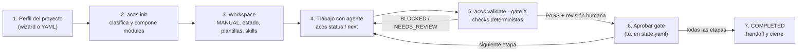

# Agentic Consulting OS (ACOS)

Método modular de consultoría **Data & AI** y una CLI (`acos`) que lo compila en un **workspace de proyecto** listo para trabajar con un agente (Claude Code o Codex): estructura de carpetas, manual operativo, plantillas, etapas con *gates* y las skills disponibles de tu Foundry.

> **Idea central:** el agente ejecuta tareas acotadas; **tú conservas el criterio y la aprobación**. ACOS no avanza una etapa por sí solo: un gate pasa solo con checks deterministas **más** una revisión humana registrada.

- [Para qué sirve](#para-qué-sirve) · [Flujo en 1 minuto](#flujo-en-1-minuto) · [Instalación](#instalación) · [Ejemplo e2e (5 min)](#ejemplo-e2e-5-minutos) · [Trabajar con un agente](#trabajar-con-un-agente-claude-code--codex) · [Ver un proyecto terminado](#ver-un-proyecto-terminado-piloto)
- [Qué se genera](#qué-se-genera) · [Gates y códigos de salida](#gates-y-códigos-de-salida) · [Skills y Foundry](#skills-y-foundry) · [Estado y límites](#estado-y-límites) · [Desarrollo](#desarrollo) · [Mapa del repo](#mapa-del-repo)

## Para qué sirve

Para convertir una pregunta de negocio en una decisión defendible sin saltarte pasos: definir la decisión y su dueño, entender los datos, elegir el método menos complejo que responda, ejecutar con evidencia reproducible, revisar y entregar. Sirve para análisis, experimentos, modelos predictivos, priorización y entregables ejecutivos. **No hace ML por defecto**: la ruta se elige según la decisión.

## Flujo en 1 minuto



Etapas típicas: `discovery → framing → diagnosis → execution → validation → delivery → handoff`. Se empieza en la etapa que corresponde (p. ej. `framing` si ya hay contexto). Detalle en [`workflow/project-lifecycle.md`](workflow/project-lifecycle.md).

| Comando | Qué hace | ¿Escribe archivos? |
|---|---|---|
| `acos init [nombre]` | Wizard o `--profile-file`; muestra perfil, clasificación, composición y límites **antes** de escribir | Sí, solo tras confirmar |
| `acos status` | Etapa, estado, bloqueos, gates pendientes, integridad | No |
| `acos next` | Objetivo, preguntas, outputs esperados, capacidades y brechas de la etapa | No |
| `acos validate --gate <g>` | Revisa un gate sin avanzar el estado | No |

## Instalación

Requiere Python ≥ 3.11 y [`uv`](https://docs.astral.sh/uv/) (o `pipx`).

```bash
uv tool install agentic-consulting-os      # desde PyPI
acos --version                             # 0.1.0
```

Desde este repositorio: `git clone https://github.com/davidrodriguez2712/flujo-consultor-ml.git && cd flujo-consultor-ml && uv tool install .`. Más opciones y plataformas en [`docs/acos/installation.md`](docs/acos/installation.md). No instala Claude Code ni Codex.

## Ejemplo e2e (5 minutos)

Recorrido real y reproducible: **perfil → workspace → estado → gate bloqueado → completar → gate PASS**. El script [`examples/quickstart/run.sh`](examples/quickstart/run.sh) lo ejecuta de punta a punta sin interacción; abajo está paso a paso con las salidas reales.

```bash
bash examples/quickstart/run.sh /tmp/acos-demo      # todo en uno
```

### 1. Crear el workspace desde un perfil

El perfil describe el proyecto ([`examples/quickstart/fraud-profile.yaml`](examples/quickstart/fraud-profile.yaml)):

```yaml
schema_version: 1
project: { slug: fraud, name: fraud }
engagement:
  decision: Priorizar inspecciones de fraude eléctrico
  archetypes: [PREDICT, PRIORITIZE_SELECT, OPTIMIZE]
  current_stage: framing
data: { sources: [csv], characteristics: { supervised: true, labeled: partial } }
deliverables: [decision_memo, business_case]
runtimes: [codex, claude_code]
```

```bash
acos init demo-fraude --profile-file examples/quickstart/fraud-profile.yaml
```

ACOS pide la ruta de tu Foundry (vacío = continuar sin él), muestra el **perfil propuesto** y la **clasificación** (con la regla y señal de cada arquetipo) y espera tu confirmación (`s`). Antes de escribir lista los archivos que va a crear. Si no hay una skill compatible, lo dice como *gap* y usa una pauta del OS; **no inventa skills**. No existe `--yes`: la confirmación es obligatoria.

### 2. Ver estado y siguiente paso

```bash
cd demo-fraude
acos status
```

```json
{ "project": "fraud", "stage": "framing", "status": "NOT_STARTED", "completed": [],
  "total_stages": 6, "next_gates": ["framing"], "integrity": "OK", "findings": [] }
```

```bash
acos next      # objetivo, preguntas, outputs y capacidades de la etapa
```

```json
{ "stage": "framing", "objective": "Definir decisión, owner, KPI, unidad y horizonte.",
  "questions": ["¿Qué se optimiza o mide?", "¿Cuál es la unidad y el horizonte?", "¿Quién aprueba alcance y KPI?"],
  "outputs": ["framing/framing.yaml"], "...": "capacidades, gaps y gate" }
```

### 3. Validar antes de completar → BLOCKED

```bash
acos validate --gate framing ; echo $?
```

```json
{ "status": "BLOCKED",
  "findings": [{ "code": "fields-missing",
                 "message": "framing/framing.yaml: completar owner, metric, unit, horizon" }] }
```

Código de salida `4`. Nada se modificó: `validate` nunca escribe ni avanza el estado.

### 4. Completar el entregable y registrar tu revisión

Edita `framing/framing.yaml` (el trabajo real, solo o con tu agente):

```yaml
decision: Priorizar inspecciones de fraude eléctrico
owner: Gerencia de Pérdidas No Técnicas
metric: Recuperación de energía por inspección
unit: kWh recuperados por inspección
horizon: 90 días
```

Una vez que **revisaste el contenido**, registras la aprobación en `.acos/state.yaml` (el hash está en `.acos/manifest.yaml` → `profile_sha256`):

```yaml
gate_reviews:
  framing:
    decision: PASS
    reviewer: David
    evidence:
      - framing/framing.yaml
    profile_sha256: <valor de .acos/manifest.yaml>
```

### 5. Validar → PASS

```bash
acos validate --gate framing
```

```json
{ "status": "PASS", "findings": [], "evidence": ["framing/framing.yaml"] }
```

Para pasar a la etapa siguiente, **tú** añades `framing` a `completed_stages`, cambias `current_stage` y actualizas `objective` en `state.yaml` (V1 no tiene comando automático de avance, a propósito). Repite el ciclo con cada etapa. Guía completa: [`docs/acos/project-usage.md`](docs/acos/project-usage.md).

> `PASS` combina checks deterministas con tu declaración de revisión. **No certifica que el análisis sea correcto**: una plantilla rellena no prueba que el contenido esté bien.

## Trabajar con un agente (Claude Code / Codex)

Dentro del workspace abre tu runtime y arranca así:

```bash
cd demo-fraude
claude            # o: codex
```

Prompt de inicio sugerido: *«Lee MANUAL.md y PROJECT.md; ejecuta `acos status` y `acos next`; propón el plan de la etapa actual y qué contexto te falta antes de empezar.»*

- `AGENTS.md` tiene las instrucciones compartidas; `CLAUDE.md` es un puente mínimo.
- Las skills seleccionadas se copian a `.claude/skills/` o `.agents/skills/` con versión/hash idénticos. Verifica que tu runtime las expone antes de invocarlas.
- Ciclo diario: leer estado → definir tarea con inputs/output/aceptación → consultar playbook → producir evidencia reproducible → `acos validate` → **revisión humana** → actualizar `TASKS.md`, `STATE.md`, `DECISIONS.md`.

## Ver un proyecto terminado (piloto)

[`pilots/churn-retencion-sintetico/`](pilots/churn-retencion-sintetico/) es un workspace sintético que recorrió las 7 etapas y cerró en `COMPLETED`. Cópialo fuera del repo y explóralo:

```bash
cp -r pilots/churn-retencion-sintetico /tmp/piloto && cd /tmp/piloto
acos status                    # status: COMPLETED, integrity: OK, 7 etapas completadas
acos validate --gate handoff   # PASS
```

Lee `PILOT_REPORT.md`, `handoff/runbook.md` y `handoff/closure.md` para ver cómo luce un cierre real. Otros pilotos: `retail-valor-90d-publico`, `retail-capacidad-semanal-publico`, `riesgo-credito-sintetico`. Un caso narrado (activación de tarjetas, ficticio): [`examples/synthetic/card-activation.md`](examples/synthetic/card-activation.md).

## Qué se genera

```text
demo-fraude/
├── .acos/                 # canónico: project-profile, modules, state, manifest (hashes)
├── AGENTS.md  CLAUDE.md   # instrucciones para el agente
├── MANUAL.md  PROJECT.md  # cómo operar y qué se decidió
├── STATE.md  TASKS.md  DECISIONS.md  CAPABILITIES.md
├── context/ framing/ analysis/ modeling/ validation/ delivery/ handoff/ ...   # según etapas y módulos
└── playbooks/ workflow/   # guías copiadas, sin dependencia del checkout
```

Fuente de verdad: `.acos/*`. `STATE.md` y la cabecera de `MANUAL.md` son vistas que el agente refresca al cerrar sesión. **No edites los snapshots**; un cambio de perfil o composición exige compilar un workspace nuevo (V1 no ofrece *update*).

## Gates y códigos de salida

| Código | Significado |
|---|---|
| `0` | Operación correcta / `PASS` |
| `2` | Entrada inválida |
| `3` | `NEEDS_REVIEW` (falta revisión humana) |
| `4` | `BLOCKED` / conflicto (campos faltantes, integridad) |
| `130` | Cancelación |

Un `acos status` exitoso **no** significa gate aprobado. Un gate no pasa con reviewer vacío, evidencia ausente, hash distinto o campos obligatorios incompletos (framing exige `decision`, `owner`, `metric`, `unit`, `horizon`).

## Skills y Foundry

El **Foundry** (`~/david-skill-foundry` por defecto) es tu carpeta de skills reutilizables. ACOS solo lee `experiments/skills/` y `stable/`, y selecciona por capacidad; si no hay una skill compatible, lo declara como *gap* y cae a una pauta del OS. Ciclo de vida de capacidades: [`workflow/capability-lifecycle.md`](workflow/capability-lifecycle.md).

**Las skills están en estado `experimental`: úsalas con revisión humana de sus outputs.** Por ejemplo `detect-leakage` 0.2.x (auditoría de data leakage) tiene evidencia limitada: una sola ejecución nativa aceptable *con reservas*, sin baseline ni generalización demostrada. Detalle y límites en [`docs/acos/validation/`](docs/acos/validation/) y [`docs/acos/implementation-record.md`](docs/acos/implementation-record.md). El formato de la metadata (`status`/`version` en la raíz o bajo `metadata:`) es aceptado por el compilador.

## Estado y límites

- **ACOS 0.1.0** publicado en PyPI. Verificado en macOS, Linux (Docker) y Windows x64/ARM64; probado con Claude Code y Codex. Matriz y límites en [`docs/acos/release.md`](docs/acos/release.md).
- Que pasen los tests del compilador **no** prueba la eficacia de las skills ni la calidad de un análisis.
- Un adapter LLM opcional (`acos init --llm`) solo corre con tu consentimiento y nunca recibe datos del cliente.
- Aísla el trabajo de cada cliente con controles de acceso reales: una carpeta o repo organiza, pero no es una barrera de seguridad.

## Desarrollo

```bash
uv sync --extra dev
uv run python -m pytest -q            # 264 tests
uv run python -m build --no-isolation # wheel + sdist
```

## Mapa del repo

| Ruta | Contenido |
|---|---|
| [`AGENTIC_CONSULTING_OS.md`](AGENTIC_CONSULTING_OS.md) | Manual del método: principios, ciclo, rutas (`RESEARCH`, `ANALYSIS`, `EXPERIMENT`, `MODEL`, `BUILD`, `DELIVERY`, `PRODUCT_UI`) |
| `src/acos/` | Compilador y CLI |
| `workflow/`, `playbooks/`, `templates/` | Ciclo de vida, guías por ruta y plantillas que se copian al workspace |
| `schemas/`, `operations/` | Schemas JSON de auditoría y guía de herramientas y adopción |
| `examples/` | Ejemplo e2e ejecutable y caso narrado |
| `pilots/` | Proyectos sintéticos de punta a punta |
| `evaluations/`, `docs/acos/validation/` | Evidencia de evaluación de skills y de plataformas |
| `tests/` | Suite del compilador |

## Licencia

[MIT](LICENSE) © 2026 David Rodríguez.

Documentación: [instalación](docs/acos/installation.md) · [uso de un proyecto](docs/acos/project-usage.md) · [distribución y límites](docs/acos/release.md).
